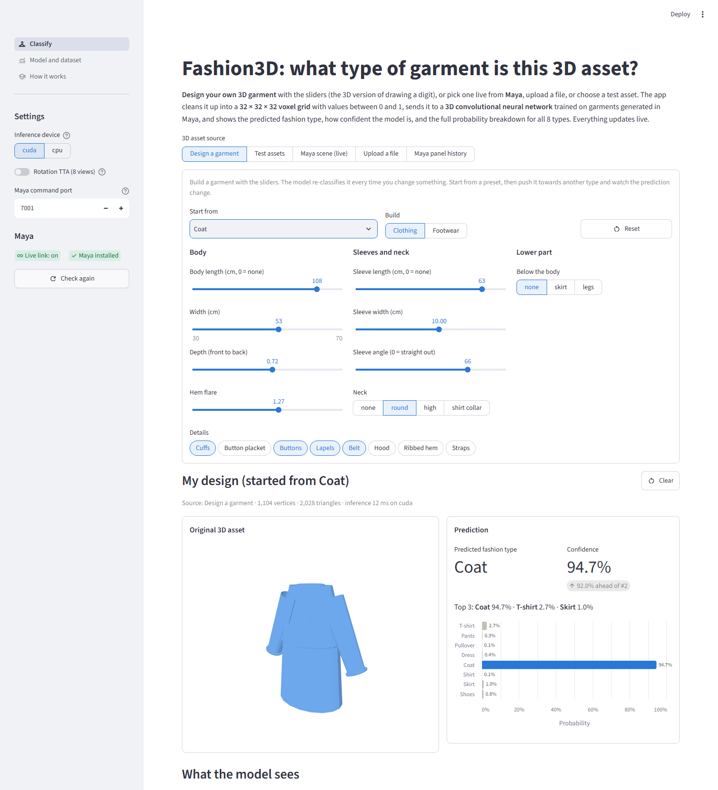
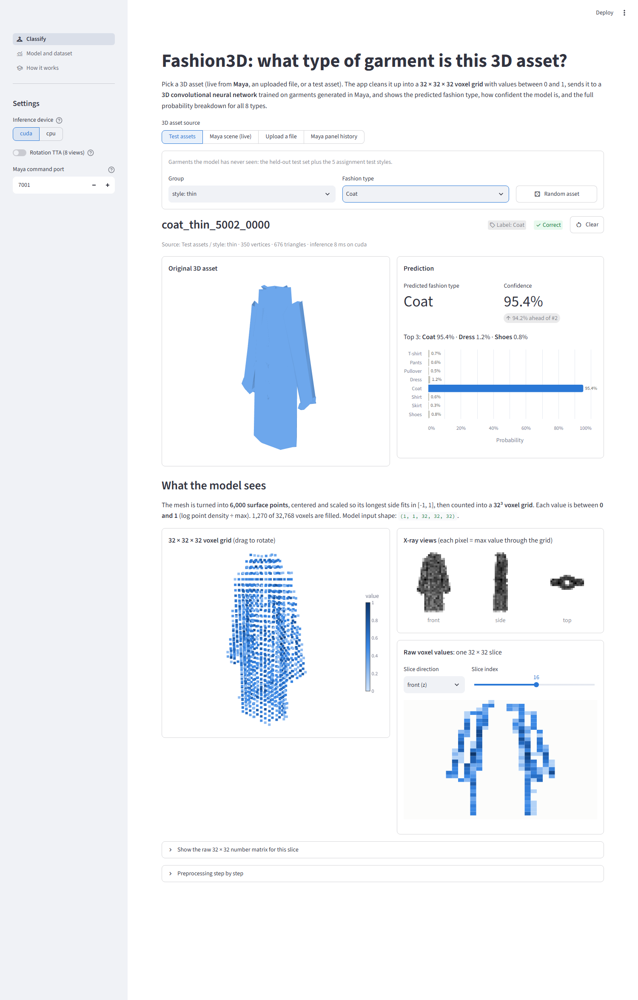
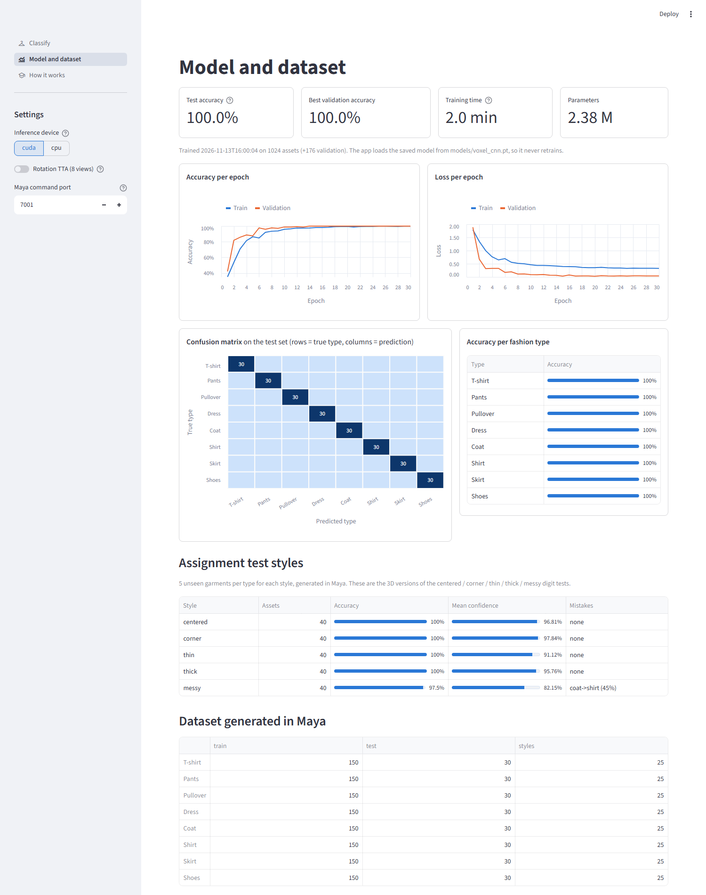
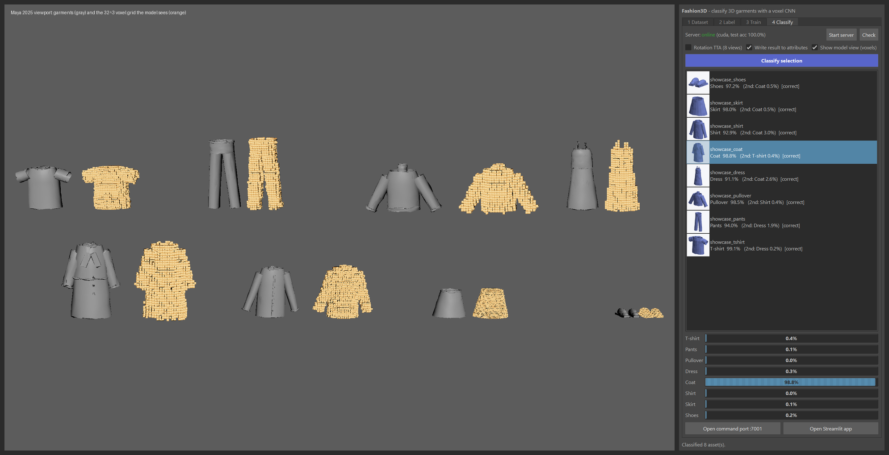
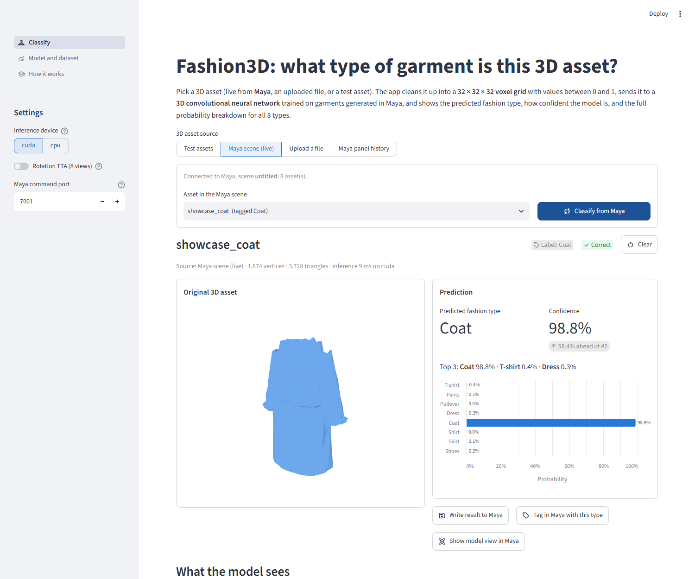

# Fashion3D: classifying 3D garments from Maya with a voxel CNN

**Mini project: MNIST digit classifier, rebuilt in 3D.**

Design a 3D garment in your browser and watch a 3D neural network guess what it is, live: T-shirt, pants, pullover, dress, coat, shirt, skirt or shoes.

**Live app:** https://3dfashionclassifier.streamlit.app/ · **Code:** https://github.com/elias3d/3D_Fashion_Classifier

My instructor let me change the original assignment. Instead of drawing a digit on a 2D canvas, my app takes a
**3D garment asset** (designed in the app, uploaded, or straight from **Autodesk Maya**) and predicts which of
**8 fashion types** it is.

The pipeline is the same idea as MNIST, but in one more dimension:

```
MNIST:      draw digit  -> grayscale -> resize 28x28      -> /255 (0..1)        -> 2D CNN -> 10 digits
Fashion3D:  Maya asset  -> surface points -> center+scale -> voxelize 32x32x32 (0..1) -> 3D CNN -> 8 fashion types
```

> ### How to open it
> - **Online, no install:** **https://3dfashionclassifier.streamlit.app/**. Works in any browser. The Maya features are
>   locked there, because Maya can only connect to an app running on the same computer.
> - **On your computer:** unzip, then double-click **`run_windows.bat`** (Windows) or run **`bash run_mac_linux.sh`**
>   (Mac / Linux). The first run installs everything into a private Python environment (on Windows in
>   `%LOCALAPPDATA%\Fashion3D\venv`, to avoid Windows' long-path limit). It detects an NVIDIA GPU and installs the
>   CUDA version of PyTorch if there is one (~3 GB), otherwise the CPU version (~200 MB). Then the app opens at
>   http://localhost:8517. Needs [Python 3.10–3.12](https://www.python.org/downloads/). Maya is optional.



---

## What I built

| Part | What it does |
|---|---|
| **Maya garment generator** (`maya_tools/garments.py`) | Builds placeholder garments from Maya primitives (`polyPipe`, `polyTorus`, `polyCube`, `polySphere`) with random proportions, so no two are the same. |
| **Labelling** (`maya_tools/maya_mesh.py`, `dataset_tools.py`) | Every asset gets a `fashionType` attribute in Maya. The label also lives in the folder name and in `manifest.csv`. You can tag your own imported FBX assets in the panel. |
| **Dataset export** | Each asset is saved as `.fbx` (the 3D asset) + `.npz` (the triangles the ML pipeline reads). |
| **Preprocessing** (`fashion3d/preprocess.py`) | Mesh → 6,000 surface points → center and scale to [-1, 1] → 32 × 32 × 32 voxel grid with values 0 to 1. Pure numpy, so the *same* code runs inside Maya and in the app. |
| **Model** (`fashion3d/model.py`) | VoxelCNN: a 3D convolutional network (2.38 M parameters), PyTorch. |
| **Training** (`scripts/train.py`) | Trains on GPU (CUDA) or CPU, saves `models/voxel_cnn.pt`. It can be started from the Maya panel, which shows a live progress bar and log. |
| **Inference server** (`scripts/serve.py`) | Maya sends a mesh over local HTTP and gets the prediction back. (Maya has its own Python, and installing PyTorch + CUDA into it is fragile, so the model runs next to Maya instead.) |
| **Maya panel** (`maya_tools/panel.py`) | Dockable panel with 4 tabs: **Dataset**, **Label**, **Train**, **Classify**. Classify shows thumbnails, confidence and probability bars, writes the result onto the node, and can build a voxel "model view" twin next to the asset. |
| **Garment designer** (`fashion3d/builder.py`) | The 3D version of the drawing canvas: sliders and toggles (body length, width, flare, sleeves, neck, skirt or legs, details, or footwear) build a 3D garment in the browser with numpy, no Maya needed. It uses the same recipe as the Maya generator, so the model recognises its garments. |
| **Streamlit app** (`app.py`) | Title and description, 5 input sources (**design a garment**, test assets, **live Maya scene through the command port**, file upload incl. FBX, Maya panel history), prediction, confidence, top 3, probability chart, and "what the model sees" (3D voxel grid, X-ray views, raw 32 × 32 slices and the number matrix), all updating live. |

### Original requirement → my 3D version

| Assignment requirement | In this project |
|---|---|
| Title & description | Title + explanation at the top of the Classify page |
| Drawing canvas | **Design a garment**: an interactive 3D "canvas" where you shape a garment with sliders and toggles and see it in 3D (drag to rotate) while the prediction updates. You can also pick an asset live from the open Maya scene, upload one (FBX/OBJ/STL/PLY/GLB), or choose one from the test sets |
| Grayscale, resize to 28 × 28, normalize 0–1 | Surface sampling, center + scale, voxelize to **32 × 32 × 32**, log-density ÷ max → **0–1**, input shape `(1, 1, 32, 32, 32)` |
| Model prediction for all 10 digits | Softmax probabilities for all **8 fashion types** |
| Predicted digit, confidence, chart | Predicted type, confidence (and lead over #2), top 3, bar chart of all 8 |
| Show the processed 28 × 28 image | 3D voxel grid you can rotate, front/side/top X-ray views, a slice viewer, the raw number matrix, and in Maya an actual voxel mesh next to the asset |

### Stretch goals done

- [x] Top 3 predictions
- [x] Clear/Reset button
- [x] Raw pixel (voxel) matrix
- [x] Confusion matrix on the test set ("Model and dataset" page)
- [x] Saved model: the app loads `models/voxel_cnn.pt` and never retrains
- [x] "How it works" page explaining the CNN pipeline
- [x] Better preprocessing for off-center / oddly sized inputs: centering + scaling makes position and units irrelevant, and stronger augmentation fixed slim and bulky garments (see testing)
- [x] Extra: GPU/CPU choice, rotation test-time augmentation (8 views), FBX support through headless Maya, two-way Maya ↔ Streamlit link

**What the model sees:** a thin coat from the test styles, with the 32 × 32 × 32 voxel grid, X-ray views and a
raw slice of values between 0 and 1:





**In Maya 2025:** the Fashion3D panel (right) classified all 8 showcase garments correctly, and the orange blocks
next to each garment are what the model actually sees (its 32 × 32 × 32 voxel grid), built as a real mesh in the
scene:



**Streamlit driving Maya live** through the command port. The asset list comes from the open scene, and the
buttons write the result back into Maya:



---

## Setup

**Needs:** Python 3.10–3.12 (Windows, Mac or Linux). Optional: Autodesk Maya 2025+ (Windows) for the Maya
features, and an NVIDIA GPU for faster training.

The easy way is `run_windows.bat` / `run_mac_linux.sh` (see *How to open it* at the top). By hand:

```bash
# 1. Python packages
python -m venv .venv
.venv\Scripts\activate                 # Mac/Linux: source .venv/bin/activate
pip install -r requirements.txt        # CPU build of PyTorch, works everywhere (also used online)
#   NVIDIA GPU?  pip install -r requirements-gpu.txt  instead (CUDA build, ~3 GB, much faster training)
#   The start scripts choose for you; force one with  set FASHION3D_DEVICE=cpu  (or gpu)

# 2. Run the app
streamlit run app.py --server.port 8517

# 3. (optional) Retrain the model. The training meshes are included in data/train/.
python scripts/train.py                # ~2 min on an RTX 4090, ~5-15 min on a laptop CPU

# 4. (optional, needs Maya) Generate a brand-new dataset (about 1 minute, headless)
"C:\Program Files\Autodesk\Maya2025\bin\mayapy.exe" scripts\maya_generate_dataset.py --clean
```

**What's included:** the trained model (`models/`), the 1,200 training meshes (`data/train/`, `.npz` only, no FBX)
and a sample set (`samples/`: the 240 test + 200 style-test garments and one `.obj` per type).

**No Maya? The app still works.** The sidebar shows the Maya status, and features that need Maya are locked
rather than broken:

| Without Maya | Works? |
|---|---|
| Test assets, upload OBJ / STL / PLY / GLB, Model page, How it works | Yes |
| Upload FBX | Locked: needs Maya installed |
| Maya scene (live) | Locked: needs Maya open with port 7001 (click *Check again* after opening it) |
| Generating a new dataset | Needs Maya |

**Using it from Maya:**

1. Drag and drop `install_maya.py` into the Maya viewport. It adds a **Fashion3D** shelf button and opens the panel.
2. **Classify** tab → **Start server** (it uses the project's `.venv` Python with PyTorch).
3. Select garments → **Classify selection**. Tick *Show model view (voxels)* to build the voxel twin.
4. **Open command port :7001** lets the Streamlit app list, classify, tag and select assets in your open scene
   (Streamlit → *Maya scene (live)*).
5. The **Dataset**, **Label** and **Train** tabs do steps 2–3 above from inside Maya, plus importing and tagging your
   own FBX files.

Tip: **Dataset → Build showcase** creates one garment of each type in your scene to try the panel on.

### Project layout

```
app.py                     Streamlit entry point
app_pages/                 classify / model and dataset / how it works
fashion3d/                 shared Python: classes, preprocess, model, dataset, inference, render, ui, maya_bridge
maya_tools/                Maya side: garments, styles, dataset_tools, panel, actions, client, bridge
scripts/                   maya_generate_dataset, train, serve, stress_test, make_samples, maya_fbx_to_npz
models/                    voxel_cnn.pt (trained v2 model), metrics (v2 + v1 baseline), stress test
data/train/                1,200 labelled training meshes (.npz) + manifest.csv
samples/                   440 test garments (.npz) + one .obj per type: lets the app run without Maya
run_windows.bat            double-click: set up and open the app (Windows)
run_mac_linux.sh           same for Mac / Linux
install_maya.py            drag-and-drop installer for the Maya shelf + panel
```

### Play with it

The training data is included, so you can change things and retrain without Maya. Every run overwrites
`models/voxel_cnn.pt` and `models/metrics.json`; restart the app to see the new results on the
*Model and dataset* page. Copy the `models/` folder first if you want to keep the original.

1. **Undo my fix.** In `fashion3d/preprocess.py` set `SCALE_RANGE = (0.85, 1.15)` (the v1 setting), then run
   `python scripts/train.py`. Watch the *thin* test style drop from 100% back below 80%, with slim garments
   called "pants".
2. **Train too little.** `python scripts/train.py --epochs 3`, then look at the confusion matrix: which types get
   mixed up first?
3. **Make it harder.** In `fashion3d/preprocess.py`, lower `GRID` from 32 to 16 (a blurrier "image") or `N_POINTS`
   from 6000 to 500 (a sparser surface). How much detail does the model really need?
4. **Stress it.** `python scripts/stress_test.py` rotates the test garments onto their side. Then add
   X/Z rotations to `augment_points()` and see if you can fix the "lying down = shoes" problem.

---

## Testing

The dataset was generated in Maya: **150 training garments per type** (1,200 total, with 15% held out for
validation) and **30 test garments per type** made with a different random seed, so the model never saw them.

**Test accuracy: 100% on 240 unseen garments.** I don't think this number alone proves much. All garments come from
my own generator, so train and test look alike, and real artist-made assets would be harder. That is why the
style tests below matter more.

### The 5 drawing styles, translated to 3D

I generated 5 new garments per type for each style (40 per style) in Maya:

| Style | What I did to the 3D asset | 2D equivalent |
|---|---|---|
| Centered | Normal garment at the world origin | Centered digit |
| Corner | Moved up to 900 cm away from the origin and spun to a random angle | Digit drawn near the corner |
| Thin | Low-poly (40% of the polygons) and squeezed to 50–65% width | Thin pen stroke |
| Thick | `polySmooth` + inflated to 140–170% width | Thick marker |
| Messy | Noisy vertices, 15% of the faces deleted (holes), a random stray sphere, tilted up to 18° | Messy / unclear digit |

**Results.** v1 was my first model. v2 is the same network after I improved the augmentation.

| Style | v1 accuracy | v1 mean confidence | **v2 accuracy** | v2 mean confidence | What happened |
|---|---|---|---|---|---|
| Centered | 100% | 97.7% | **100%** | 96.8% | Easy, like the training data. |
| Corner | 100% | 97.9% | **100%** | 97.8% | Position doesn't matter at all: preprocessing re-centers and re-scales every mesh, so a coat 9 m from the origin gives the same voxel grid as one at the origin. |
| Thin | **72.5%** | 71.4% | **100%** | 91.1% | v1 called 7 of 40 slim garments **pants** (e.g. slim shirts → pants 53–67%, slim coat → pants 65–69%). Squeezed tubes look like trouser legs. |
| Thick | 90% | 83.7% | **100%** | 95.8% | v1 confused bulky dresses with skirts (37–46%) and bulky shirts with pullovers (39–43%). Both make sense: a pullover *is* a bulkier shirt without a collar. |
| Messy | 100% | 82.8% | **97.5%** | 82.1% | Still correct, but confidence drops about 15 points. v2's one mistake: a messy coat → shirt at only 45% (coat was 39%). |

**What I changed between v1 and v2:** v1's training augmentation only stretched garments 0.85–1.15×. The
model had learned "a very narrow vertical shape = pants" from proportions alone. In v2, every training sample gets
its width and depth scaled randomly between 0.55× and 1.6× (log-uniform), so the network has to learn **parts**
(sleeves, collars, the split between two legs, a flared hem) instead of proportions. Thin went from 72.5% to 100%,
and thick from 90% to 100%, with the same test accuracy.

### Playing with the garment designer

Starting from a preset and changing one thing at a time shows where the model draws the line between types:

| What I did in the designer | Prediction |
|---|---|
| T-shirt preset | T-shirt 98.7% |
| … sleeves lengthened from 19 to 60 cm | **Shirt 53.8%**: unsure, right on the border |
| … sleeves angled down (70°) | Shirt 90.9% |
| … body made 110 cm long and flared | **Coat 95.3%** |
| Pants preset, then *skirt* instead of *legs* below | Skirt 87.7% |
| Dress preset, then body length set to 0 | Skirt 85.1% |
| … skirt shortened to 20 cm | Skirt 69.8%: confidence drops for a shape it never saw |
| Shoes preset, then a 20 cm boot shaft | Shoes 98.4% |

All 8 presets are classified correctly (92–99%). The T-shirt → shirt → coat sequence shows the model really
uses sleeve length, sleeve angle and body length, the same features a person would use.

### Live test inside Maya 2025

I ran the whole loop in a real Maya 2025 session (not just headless):

| Step | Result |
|---|---|
| Drag-and-drop `install_maya.py` | Shelf button + docked panel; it found the project's Python automatically |
| Panel → *Start server* | Server started from inside Maya, running on the GPU (cuda) |
| *Build showcase* + *Classify selection* with *Show model view* | **8 / 8 correct**, confidence 91.1% (dress) to 99.1% (T-shirt); 8 voxel twins built; `fashionPredicted` / `fashionConfidence` written on every node |
| Streamlit → *Maya scene (live)* | Listed the 8 scene assets with their tags; *Classify from Maya* exported the coat's 1,874 vertices and classified it (Coat 98.8%) in about 0.2 s |
| Streamlit → *Write result to Maya* / *Show model view in Maya* | After I deleted the coat's twin and attribute in Maya, the buttons re-created both |

One thing I learned: Maya's command port sometimes ran the same message twice (my first showcase got built two
times). I made every bridge request run-once, by remembering request IDs that were already handled.

### Extra stress test: garments that aren't standing up

I also rotated all 240 test garments around the X axis (`python scripts/stress_test.py`):

| Pose | Accuracy | Mean confidence | Most common mistake |
|---|---|---|---|
| Upright | 100% | 96.1% | none |
| Lying down (90°) | **8.3%** | 79.9% | almost everything → **shoes** |
| Upside down (180°) | 5.4% | 53.8% | dress → pants, pullover → T-shirt |

This was the most interesting result. A coat lying down is long and flat, which is exactly what a shoe looks like
to the model, and it says "shoes" with about 80% confidence. **High confidence does not mean correct.** The model
only ever saw Y-up garments, which is what Maya assets normally are. If I needed to handle any pose, I would add
random X/Z rotations to training, or align each mesh to its main axes (PCA) before voxelizing.

---

## Reflection

**1. How does a computer represent a handwritten digit as data? (and a 3D garment?)**
A digit is a grid of numbers: 28 × 28 = 784 pixels, each one a brightness value. The computer doesn't "see" a
7, only 784 numbers. A 3D asset in Maya is stored as vertices (xyz positions) and faces (which vertices make each
triangle). That's a list whose length changes from asset to asset, and a CNN needs a fixed-size input. So I
convert it into a fixed grid like MNIST, just in 3D: 32 × 32 × 32 = 32,768 voxels, each one a number saying how
much surface passes through that little cube.

**2. Why does the model use a 28 × 28 image? (and why 32³?)**
A neural network has a fixed number of inputs, so every example has to be the same size. 28 × 28 is small enough
to train fast but still keeps the shape of a digit. I picked 32 × 32 × 32 for the same reason. 32³ is already 41×
more values than 28², and 64³ would be 8× more again, which costs a lot more memory and time. At 32³ you can still
clearly see sleeves, collars, legs and soles (look at the X-ray views in the app). 32 also divides cleanly by 2
three times (32 → 16 → 8 → 4), which fits the network's downsampling.

**3. Why are pixel values normalized between 0 and 1?**
Neural networks train best when inputs are small and on the same scale. Raw 0–255 pixels, or in my case raw point
counts that can be 1 or 60, would make the gradients jump around and the learning rate hard to choose. I also
normalize **size and position**: every garment is centered and scaled to fit in [-1, 1]. That's why the "corner"
test (garments 9 m away) and the FBX imported in different units still work. Without it, the model would be
learning where an asset is and how big the units are, not what it is.

**4. What does the confidence score represent?**
It's the softmax probability of the top class: the network's own estimate of how likely its answer is, out of
the 8 types (the 8 numbers add up to 100%). It is **not** a guarantee. My stress test showed garments lying down
classified as shoes with about 80% confidence while being wrong 92% of the time. Confidence only means something
for inputs that look like the training data. The gap to the second-best class is useful too. My one messy mistake
was shirt 45% vs coat 39%, almost a coin flip (re-running it with a different random point sampling gives
shirt 41% vs coat 40%). The app warns when confidence drops below 60%.

**5. Which type of drawing was hardest for my model, and why?**
For v1 it was **thin** garments (72.5%). Squeezing a shirt or coat narrows its sleeves and body into long vertical
tubes, and the model had learned that "narrow vertical tubes = pants". It was using proportions as a shortcut
because, in the training data, proportions alone were enough to separate the classes. After I added stronger
proportion augmentation, the hardest became **messy** (97.5%, and the lowest confidence). Holes and noise remove
the small details that separate similar types: the collar and button placket are what make a shirt different
from a coat or pullover, and when those are broken the model hesitates. The hardest case of all was the one I
didn't plan for: garments lying on their side (8%).

**6. What's the difference between training a model and using it for inference?**
Training is the expensive learning part. The model sees 1,024 labelled garments 30 times, compares its answers with
the labels, and adjusts 2.38 million weights with backpropagation. That took about 2 minutes on the GPU and uses
random augmentation and dropout. Inference uses the finished, frozen weights: one garment goes forward through the
network once and a prediction comes out in about 5–10 ms, with no labels, no learning and no randomness (dropout is
off). That's why I save the trained model to `voxel_cnn.pt`: the app and the Maya panel just load it, and they
never retrain unless I click *Train* again.

**7. How could I improve this application in the future?**
- **Real assets:** train on real artist-made garments (for example from an asset library) labelled with the panel's
  Label tab. My procedural garments are much cleaner and more alike than real ones.
- **Any orientation:** random X/Z rotations during training, or PCA alignment, to fix the "lying down = shoes" problem.
- **Better 3D models:** try PointNet (works on points directly, no voxel grid) or a higher-resolution 64³ grid for
  details like buttons and pockets.
- **More classes and attributes:** jackets, shorts, hats, sleeve length, or style (casual / formal), using more
  output heads.
- **"I don't know" option:** reject predictions under a confidence threshold, or detect inputs that look nothing
  like the training data, instead of confidently guessing.
- **Pipeline tools:** batch-classify a whole asset library and write the type into the asset metadata, so artists
  can search "all coats".

---

## Files

| File | Contents |
|---|---|
| `app.py` + `app_pages/` | The Streamlit application |
| `requirements.txt` | Packages needed to run the app |
| `README.md` | This file: setup, explanation, testing results, reflection |
| `screenshots/` | The app running (garment designer, classify, model, live Maya mode) and the panel + voxel twins in Maya 2025 |
| `maya_tools/`, `install_maya.py` | Maya panel and tools |
| `models/` | Trained model and metrics (so it runs without retraining) |

The training meshes are included (`data/train/`, 24 MB). The FBX versions of the assets aren't (another ~50 MB);
Maya regenerates everything with step 4 of the setup.
